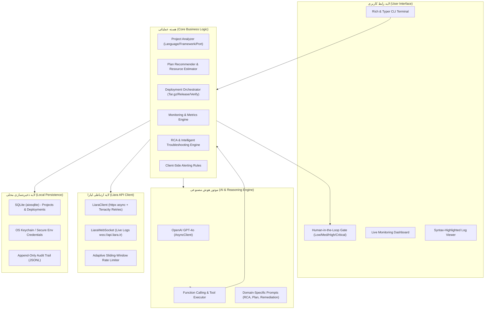

# 🏗️ معماری فنی و ساختار سیستم Liara SRE Agent
## Architecture Specification & Engineering Manual

> **Liara SRE Agent** یک دستیار هوشمند مهندسی قابلیت اطمینان (SRE Copilot) و اپراتور خودکار برای استقرار، مانیتورینگ، عیب‌یابی و مقیاس‌پذیری اپلیکیشن‌ها بر بستر ابری **Liara PaaS** است.

---

## ۱. نمای کلی معماری (System Architecture)

معماری سیستم بر پایه یک الگوی لایه‌ای ماژولار (Layered Modular Architecture) همراه با مکانیزم نظارت انسانی (**Human-in-the-Loop**) و قابلیت عملکرد ترکیبی (AI Reasoning + Heuristic Fallback) طراحی شده است:



---

## ۲. لایه‌های سیستم و جریان داده (Data & Execution Flow)

### ۲.۱. لایه تحلیل پروژه و استقرار اولیه (`core/analyzer.py` & `core/deployer.py`)
1. **کاوش فایل‌ها**: پویش ساختار فایل‌ها، شناسایی مارکرهای فریم‌ورک‌ها (`package.json`, `requirements.txt`, `go.mod`, `Dockerfile`, `composer.json`, `Cargo.toml`).
2. **استخراج تنظیمات**: استخراج پورت پیش‌فرض و متغیرهای محیطی مورد نیاز با تحلیل الگوهای Regex سورس‌کد.
3. **پیشنهاد پلن بهینه (`core/planner.py`)**: ماتریس تصمیم‌گیری مبتنی بر فریم‌ورک و تعداد پکیج‌ها جهت مپ کردن نیازمندی‌ها به پلن‌های لیارا (`micro` تا `xxlarge`).
4. **بسته‌بندی و ارسال**: ساخت آرشیو `.tar.gz` فشرده با فیلتر خودکار دایرکتوری‌های غیرضروری (`.git`, `node_modules`, `venv`, `__pycache__`).
5. **ارسال چندبخشی (Multipart Upload)** به اندپوینت `/v2/projects/{name}/sources`.
6. **ثبت ریلیز و پولینگ وضعیت**: استقرار به اندپوینت `/v2/projects/{name}/releases` و استعلام مداوم وضعیت کانتینرها تا حصول تایید سلامت (`isDeployed: true`).

### ۲.۲. لایه پایش و سلامت سرویس (`core/monitor.py` & `core/alerting.py`)
- واکشی مداوم شاخص‌های مصرف CPU, Memory, Network از طریق اندپوینت `/v1/projects/{name}/reports`.
- اعمال موتور ارزیابی آستانه‌ها (Threshold Alerting):
  - مصرف حافظه رم بالای ۸۵٪: هشدار زودهنگام خطر خطای حافظه (Out Of Memory).
  - مصرف پردازنده بالای ۸۰٪: پیشنهاد مقیاس‌دهی (Scale Up/Out).
- نمایش داشبورد دینامیک ترمینال با کتابخانه `rich.live`.

### ۲.۳. لایه عیب‌یابی هوشمند و تحلیل علت ریشه‌ای (`core/debugger.py` & `ai/engine.py`)
1. **بسته‌بندی کانتکست (Context Bundle)**: واکشی همزمان آخرین ۴۰ خط لاگ، رویدادهای دیپلوی، وضعیت پادها و متغیرهای محیطی.
2. **تحلیل ریشه‌ای (RCA)**: ارسال ساختار به هوش مصنوعی (GPT-4o) با پرامپت مهندسی شده جهت دسته‌بندی خطا:
   - `RESOURCE_EXHAUSTION` (خطاهای OOMKilled و کمبود رم)
   - `CONFIG_ERROR` (تداخل پورت یا خطای متغیرهای محیطی)
   - `CODE_BUG` (اکسپشن‌های نرم‌افزاری و Unhandled Rejections)
   - `NETWORK_ISSUE` (عدم اتصال به دیتابیس یا سرویس‌های ابری)
3. **فرضیات دارای اولویت (Prioritized Hypotheses)**: خروجی ساختاریافته شامل احتمال وقوع (Probability)، اثر بر سیستم و راهکار متناظر.
4. **چرخه راستی‌آزمایی (Verification Loop)**: پس از اجرای عملیات اصلاحی (مثل تغییر پلن یا ری‌استارت)، ایجنت مجدداً وضعیت پروژه را برای تایید بازگشت به شرایط پایدار پایش می‌کند.

---

## ۳. نحوه اتصال به API لیارا (Liara API Integration)

### ۳.۱. مدل احراز هویت و کلاینت امن
- کلاینت ارتباطی (`LiaraClient`) بر پایه کتابخانه ناهمگام `httpx.AsyncClient` با مدیریت چرخه حیات (Context Manager) پیاده‌سازی شده است.
- احراز هویت از طریق هدر استاندارد صورت می‌گیرد:
  ```http
  Authorization: Bearer <LIARA_API_TOKEN>
  ```
- مدیریت توکن‌ها با لایه امنیتی دوگانه: ترجیح ذخیره‌سازی در **OS Keychain / Keyring** سیستمی و در صورت عدم پشتیبانی پلتفرم، ذخیره محلی با مجوزهای محدود در `.env`.

### ۳.۲. مدیریت نرخ درخواست و تاب‌آوری (Rate Limiting & Resilience)
- **Sliding-Window Throttling**: مانیتورینگ نرخ درخواست‌های ارسالی کلاینت (سقف محافظه‌کارانه ۶۰ درخواست خواندن و ۲۰ درخواست نوشتن در دقیقه).
- **Exponential Backoff**: بهره‌گیری از دکوراتور `tenacity.retry` برای مدیریت وقفه‌های شبکه یا کدهای خطای موقت سرور با فاکتور افزایش تصاعدی تا ۳ مرتبه تلاش مجدد.
- **Rate Limit Handlers**: رهگیری کد خطای HTTP 429 و خواندن هدر `Retry-After`.

### ۳.۳. استریم زنده لاگ‌ها (WebSocket Streaming)
- کلاس `LiaraWebSocket` مستقیماً به آدرس زیر متصل شده و لاگ‌های زنده بیلد و اجرا را دریافت می‌کند:
  ```
  wss://api.liara.ir?token=<api-token>&cmd=/bin/bash&project_id=<project-id>
  ```
- در صورت قطع شدن اتصال وب‌سوکت، سیستم به صورت خودکار بدون اختلال در رابط کاربری به الگوریتم پولینگ تاریخی (`GET /v1/projects/{name}/logs?since=...`) سوئیچ می‌کند (Graceful Degradation).

---

## ۴. مدل نظارت انسانی (Human-in-the-Loop Security Model)

یکی از ارکان اساسی داوری و استانداردهای پایداری، اطمینان از عدم اجرای ناخواسته عملیات مخرب یا پرریسک توسط ایجنت است:

| سطح ریسک (Risk Level) | نوع عملیات | رفتار ایجنت | شیوه تایید کاربر |
|-----------------------|-----------|-------------|------------------|
| **🟢 LOW** | لیست پروژه‌ها، دریافت لاگ، بررسی وضعیت و متریک‌ها | اجرای خودکار بدون معطلی | اطلاع‌رسانی در ترمینال |
| **🟡 MEDIUM** | راه‌اندازی مجدد (Restart)، تغییر متغیر محیطی، دیپلوی نسخه جدید | توقف و نمایش خلاصه عملیات | سوال استاندارد `[Y/n]` |
| **🔴 HIGH** | خاموش/روشن کردن (Scale 0/1)، تغییر پلن سخت‌افزاری (Resize) | نمایش اثرات و هشدار ریسک | سوال محتاطانه `[yes/NO]` (پیش‌فرض خیر) |
| **⛔ CRITICAL** | حذف کامل پروژه (Delete Project) | هشدار تخریب داده و منابع | الزام به تایپ کلمه `"CONFIRM"` |

---

## ۵. ممیزی و تاریخچه‌نگاری تغییرات (Audit Logging)

تمامی عملیات حساس و تغییرات سیستمی در فایل لاگ تغییرناپذیر ثبت می‌شوند:
- **مسیر ذخیره‌سازی**: `AppData/Local/liara-agent/audit.log` (ویندوز) یا `~/.local/share/liara-agent/audit.log` (لینوکس/مک).
- **فرمت**: JSON Lines حاوی فیلدهای `timestamp` (UTC ISO-8601)، `action`، `target`، `risk_level`، `status` و `details`.

---

## ۶. محدودیت‌های شناخته‌شده پلتفرم و راهکارهای جایگزین (Platform Limitations & Mitigations)

| محدودیت فنی پلتفرم لیارا | اثر بر سیستم | راهکار پیاده‌سازی شده در SRE Agent |
|--------------------------|-------------|-------------------------------------|
| عدم وجود Webhook اختصاصی برای وقایع دیپلوی | عدم امکان دریافت رویداد فشاری پایان ساخت ایمیج | پیاده‌سازی مکانیزم پولینگ هوشمند اندپوینت `/v1/projects/{name}/events` هر ۵ ثانیه |
| عدم وجود اندپوینت عمومی برای دریافت مشخصات پلن‌ها | عدم امکان خواندن لیست پلن‌ها از سرور | پیاده‌سازی کاتالوگ داخلی (`PLAN_CATALOG`) با مشخصات دقیق CPU/RAM/Disk کلیه پلن‌ها |
| عدم وجود وب‌هوک یا سیستم هشداردهی (Alerting) پیش‌فرض در API | عدم ارسال نوتیفیکیشن در زمان افزایش مصرف منابع | پیاده‌سازی موتور ارزیابی محلی آستانه‌ها (`AlertEngine`) در سمت کلاینت |
| محدودیت خواندن لاگ بر اساس Timestamp در REST | امکان از دست رفتن لاگ‌های لحظه‌ای | تلفیق استریم وب‌سوکت با سوئیچ خودکار به پولینگ دوره‌ای |
